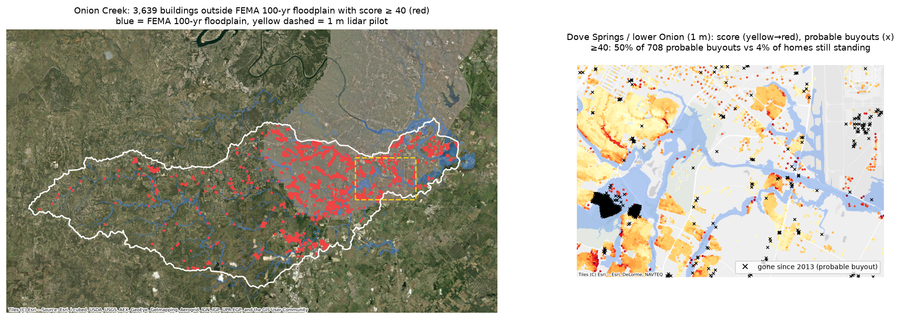

# Gradeline

Building-level water-risk features from free public data: a geospatial terrain-analysis pipeline that runs
watershed by watershed and scores every building for riverine and local (ponding) risk, with the drivers shown.
Screening only: outputs are drafts for review, not engineering or flood-zone determinations.



## What it does

- **Data (all public):** USGS Watershed Boundary Dataset (HUC-12 tiles), 3DEP 10 m DEM and 1 m lidar COG tiles
  (windowed reads), NLCD impervious surface 2001/2011/2021 and land cover, SSURGO soils, FEMA NFHL flood zones,
  Overture building footprints.
- **Terrain:** depression filling with a numba-compiled priority-flood (epsilon) fill, flow routing with pysheds,
  Height Above Nearest Drainage at 1, 10 and 100 km² stream networks (worst ratio wins, for backwater), with a
  depth-area relation fitted to HAND at FEMA AE edges; 1 m lidar for depression depth.
- **Per-building features:** depression depth, upstream contributing area, HAND and distance to the flow path,
  nearby impervious share and its change since 2001, soil hydrologic group, FEMA zone.
- **Score:** a transparent weighted 0–100 score with its top drivers (`config/scoring.yaml`), plus a flag for
  buildings outside the FEMA floodplain that score high.
- **Interfaces:** a CLI per step, maps, and a small local FastAPI service (address in, score and drivers out).

Stack: geopandas, rasterio, shapely, pyproj, pysheds, numba, exactextract, py3dep/pygeohydro, FastAPI, uv.

## Checks so far (Onion Creek, Austin TX)

- 10 m flow routing reproduces the drainage areas of 7 USGS gauges within about ±1%.
- Backtest: 708 probable buyouts (City of Austin 2013 footprints missing from current Overture data, 70% inside
  the FEMA floodplain). A score of 40 or more flags 50% of them, against about 4.5% of homes still standing nearby.

Known limitations are listed in [NOTES.md](NOTES.md); the biggest is that small DEM streams in suburbs (often
streets acting as drainage paths) likely overstate the outside-FEMA flags.

## Setup and pipeline

```bash
uv sync
uv run gradeline boundary onion_creek          # WBD HUC-12s -> area of interest + preview map
uv run gradeline fetch onion_creek             # DEM 10 m + 1 m pilot, NLCD, SSURGO, FEMA, buildings
uv run gradeline terrain onion_creek --res 10  # fill, routing, HAND (multi-scale), upstream impervious
uv run gradeline terrain onion_creek --res 1   # 1 m pilot (micro-topography)
uv run gradeline validate onion_creek          # routing vs USGS gauge drainage areas
uv run gradeline features onion_creek          # per-building features
uv run gradeline score onion_creek             # 0-100 score and drivers
```

A new watershed is a new entry in `config/watersheds.yaml`. Data lands in `data/{raw,interim,processed}/<watershed>/`
(not in git; about 1 GB for Onion Creek).

Local API:

```bash
uv run uvicorn gradeline.api:app --port 8000
curl -H "X-API-Key: dev-local" "localhost:8000/water-risk?address=6301+Bluff+Springs+Rd,+Austin,+TX+78744"
```

## License

MIT
